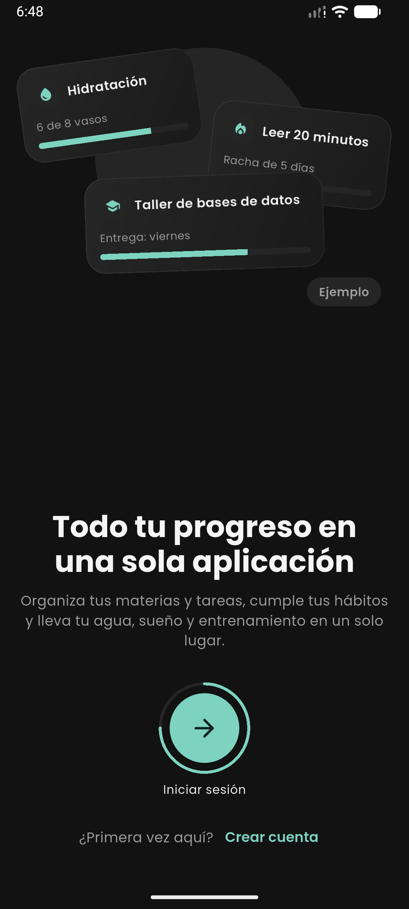
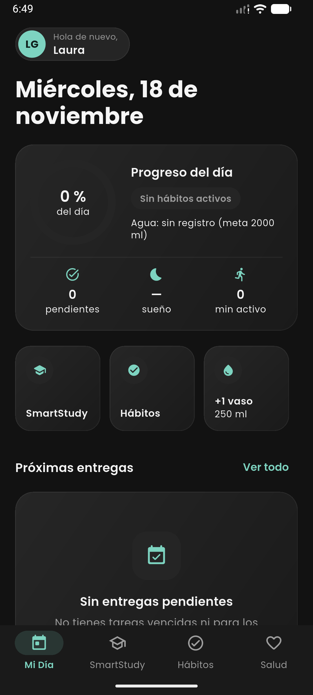
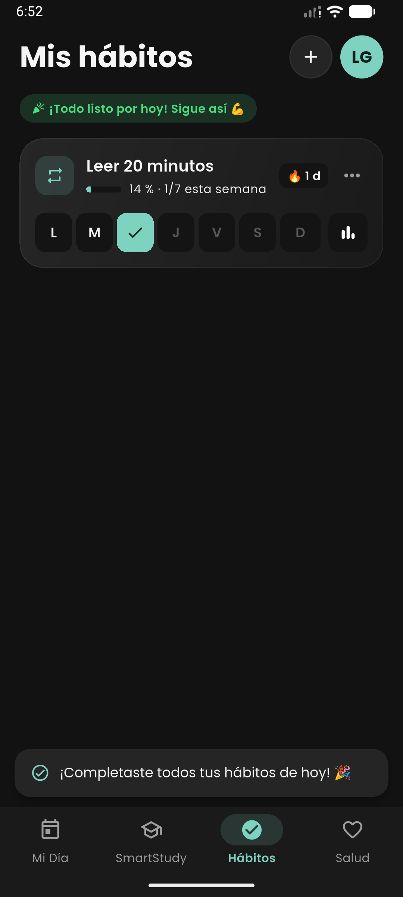
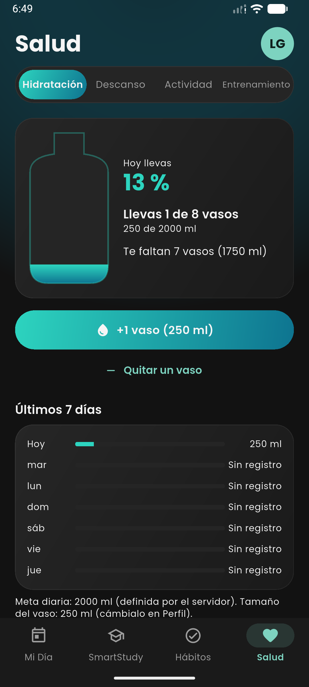

# LifeOS — App móvil (Flutter)

> «Todo tu progreso en una sola aplicación»

App Android para estudiantes que reúne **Mi Día**, **SmartStudy** (materias, tareas y evaluaciones), **Hábitos** (cumplimiento diario y rachas) y **Salud** (hidratación, descanso, actividad y entrenamiento). Usa tema oscuro en todas las pantallas y se conecta a la API REST de LifeOS (Flask + MySQL).

| Bienvenida | Mi Día | Hábitos | Salud |
|---|---|---|---|
|  |  |  |  |

*Capturas reales del emulador Android conectado al backend local (18-nov-2026).*

---

## 1. Requisitos

| Herramienta | Versión probada | Notas |
|---|---|---|
| Windows 10/11 | 10 Home 22H2 | |
| Flutter (stable) | 3.44.3 (Dart 3.12.2) | En una ruta **sin espacios**, por ejemplo `C:\flutter` |
| Android Studio | 2026.2.2 | Incluye el Java (JBR) que usa Gradle |
| Android SDK | platform `android-37.0`, build-tools 36, Command-line Tools 23 | |
| Emulador | Pixel 7, API 37 (x86_64) | Necesita aceleración (AEHD o Windows Hypervisor Platform) |
| Backend LifeOS | `D:\USUARIO\Desktop\Backend LifeOS\lifeos-backend` | Python 3.12 + MySQL 8 |

## 2. Instalación de Flutter y Android Studio (resumen)

1. Instala Flutter (rama `stable`) en `C:\flutter` y agrega `C:\flutter\bin` al PATH.
2. Instala Android Studio. En el asistente elige **Custom** y pon el SDK en una ruta **sin espacios**.
3. En **SDK Manager → SDK Tools**, marca **Android SDK Command-line Tools** y **Android Emulator hypervisor driver**. Si el driver no se instala solo, ejecuta como administrador `…\Sdk\extras\google\Android_Emulator_Hypervisor_Driver\silent_install.bat`.
4. Crea un emulador (Device Manager → Pixel 7 → API reciente).
5. Ejecuta `flutter doctor -v`: Flutter y Android toolchain deben salir sin errores.

**Configuración usada en esta PC.** C: tenía poco espacio, así que todo lo pesado va en D:, con variables de entorno de **usuario**:

| Variable | Valor |
|---|---|
| `ANDROID_HOME` | `D:\Android\Sdk` |
| `ANDROID_AVD_HOME` | `D:\Android\avd` |
| `GRADLE_USER_HOME` | `D:\Android\gradle` |
| `PUB_CACHE` | `D:\Android\pub-cache` |

## 3. Arrancar primero el backend

En PowerShell:

```powershell
cd "D:\USUARIO\Desktop\Backend LifeOS\lifeos-backend"
..\venv\Scripts\python.exe app.py        # queda en http://127.0.0.1:5000
```

Comprueba que responde en <http://127.0.0.1:5000/api/estado> («El servidor está funcionando»). MySQL (servicio `MySQL80`) debe estar encendido.

## 4. Ejecutar la app

```powershell
cd "D:\USUARIO\Desktop\Frontend LifeOS"
flutter pub get
flutter emulators --launch LifeOS_Pixel_7   # o ábrelo desde Android Studio → Device Manager
flutter run
```

### URL de la API

Está centralizada en `lib/config/api_config.dart`:

- **Emulador Android (por defecto):** `http://10.0.2.2:5000`. `10.0.2.2` es el `127.0.0.1` de la PC visto desde el emulador, así que no hay que cambiar nada.
- **Teléfono físico (misma Wi-Fi):**
  1. Averigua la IP de la PC con `ipconfig` (por ejemplo, `192.168.1.50`).
  2. Arranca el backend escuchando en la red, **con el modo debug apagado**. El backend se niega a arrancar con `FLASK_DEBUG=1` y un host de red:
     ```powershell
     $env:FLASK_RUN_HOST="0.0.0.0"; $env:FLASK_DEBUG="0"; ..\venv\Scripts\python.exe app.py
     ```
  3. Ejecuta la app con la URL de la PC:
     ```powershell
     flutter run --dart-define=API_URL=http://192.168.1.50:5000
     ```
  4. Al terminar, vuelve a `127.0.0.1`: con `0.0.0.0` cualquier equipo de la red puede llegar a la API.

### HTTP sin cifrar (solo en debug)

Android bloquea `http://` por defecto. Solo la versión **debug** lo permite, con `android:usesCleartextTraffic="true"` en `android/app/src/debug/AndroidManifest.xml`. La versión release no tiene esa línea: en producción la API debería ir por HTTPS.

## 5. Pruebas

```powershell
flutter analyze                  # análisis estático (0 problemas)
flutter test                     # 75 pruebas: modelos, servicios con MockClient, providers y pantallas
dart run tool/smoke_test.dart    # prueba de humo contra el backend REAL (encendido en 127.0.0.1:5000)
flutter build apk --debug        # demuestra que compila para Android
```

La prueba de humo registra un usuario único `smoke_<timestamp>@lifeos.test`. Luego crea, consulta y actualiza datos de **todos** los módulos e imprime `OK` o `FALLO` por paso: 38 pasos en total. Cada ejecución deja **un usuario de prueba** en `lifeos_db`.

## 6. Estructura

```
lib/
├── main.dart              # Providers, tema oscuro, español y la raíz Splash/Bienvenida/App
├── config/api_config.dart # URL base y tiempo de espera
├── theme/app_theme.dart   # AppColors + ThemeData oscuro (ningún color se escribe en las pantallas)
├── models/                # Clases con fromJson/toJson (Usuario, Tarea, Hábito, ResumenDia...)
├── services/              # ApiService (HTTP único) + un servicio por módulo
├── providers/             # Estado con ChangeNotifier (uno por módulo)
├── navigation/main_shell.dart  # Barra inferior con las 4 pestañas
├── screens/               # auth/ home/ study/ habits/ health/ profile/
├── widgets/               # LifeCard, PillButton, ProgressRing, WeekCheckRow, SegmentedTabs...
└── utils/                 # Fechas, validadores, mensajes
test/                      # Pruebas (servidor falso con MockClient)
tool/smoke_test.dart       # Prueba contra el backend real
docs/                      # Integración, pendientes del backend, capturas y referencias de diseño
```

**Flujo**, igual que las capas del backend: **Pantalla → Provider → Service → ApiService → API Flask**.

## 7. Dependencias

| Paquete | Para qué |
|---|---|
| `http` | Peticiones a la API REST |
| `provider` | Estado de la app con `ChangeNotifier` (sencillo de explicar) |
| `flutter_secure_storage` | Guarda el token de sesión cifrado (Android Keystore) |
| `intl` + `flutter_localizations` | Fechas y textos de Material en español (`es_CO`) |
| `shared_preferences` | Preferencias que **solo viven en el teléfono**: color de cada materia y tamaño del vaso |

Tipografía: **Poppins** (licencia OFL), incluida en `assets/fonts/`.

## 8. Qué se guarda dónde

- **En MySQL, a través del backend:** usuario, materias, tareas, evaluaciones, hábitos y sus cumplimientos, agua, sueño y actividades.
- **Solo en el teléfono:** el token de sesión (cifrado), el color de cada materia y el tamaño del vaso.
- **Fijo en la app:** la meta de sueño (8 h). La meta de agua la define el servidor (`META_HIDRATACION_ML`).

Más detalles en `docs/INTEGRACION_BACKEND.md` y `docs/PENDIENTES_BACKEND.md`.

## 9. Problemas frecuentes

| Síntoma | Causa y solución |
|---|---|
| «No se pudo conectar con el servidor…» | El backend está apagado. Arráncalo (sección 3) y toca **Reintentar** |
| Funciona en la PC pero no en el emulador | La URL debe ser `10.0.2.2`, no `localhost` (en el emulador, `localhost` es el propio teléfono) |
| `Cleartext HTTP traffic not permitted` | Estás ejecutando en release: usa debug, o HTTPS en producción |
| La app vuelve a la Bienvenida con «Tu sesión expiró» | El token dura 24 h y no se renueva. Inicia sesión de nuevo |
| `flutter doctor`: «Android license status unknown» | Aviso falso con las Command-line Tools 23: `sdkmanager --licenses` es obsoleto. La licencia del SDK está aceptada y `flutter build apk` compila sin problema |
| Gradle: `PKIX path building failed` | Un antivirus (Avast) inspecciona HTTPS. Se resolvió con una copia de los certificados de Java más el de Avast, configurada en `D:\Android\gradle\gradle.properties` |
| El emulador no arranca o va muy lento | Falta la aceleración: instala el *Android Emulator hypervisor driver* (sección 2) |
| C: se llena al compilar | `pagefile.sys` crece si se juntan el emulador, Android Studio y Gradle. Cierra lo que no uses y reinicia Windows para que se reduzca |
